# Pipeline de estimación de Cu, Fe y Mo — Concentrado Colectivo

Estado al **2026-10-22** (commit de este archivo). Objetivo 1 de la tesis: estimar
Cu, Fe y Mo del Concentrado Colectivo (`sample_id = 24`) desde las intensidades del
courier, reportadas en **escala balde** (la del compósito de 12 h).

Cómo leer el diagrama:

- **Rectángulos**: etapas, cada una es `notebooks/NN_*.py`, y su lógica vive en `src/pipeline/`.
- **Cilindros**: archivos en disco.
- **Hexágonos**: artefactos ajustados (`models/*.joblib`). **Todos se ajustan solo con
  `periodo == 'train'`** (hasta el 2026-05-31), así que correr el pipeline con datos
  nuevos no los cambia.
- **Líneas punteadas**: un artefacto ya ajustado que se aplica en otra etapa.
- **Notas grises**: decisiones registradas, con la sección de la bitácora o el ADR.

```mermaid
flowchart TD
    %% ============================================================
    %% FUENTES — tres crudos, uno por fuente (ADR 2026-09-30)
    %% ============================================================
    subgraph F["FUENTES"]
        BD[("BD works4cdp_assay<br/>toma PUNTUAL Lun/Mie/Vie 10-12 h<br/>intensidad + ensayo en la misma fila<br/>= muestras de CALIBRACIÓN del Outocal")]
        PI[("PI recorded — courier ConcFinal<br/>_296290_ConcFinal_Canal*<br/>5 canales, 1 lectura cada ~20 min<br/>re-archivo cada 100 s (ExcMax)")]
        CO[("PI compósito 7100AIP101-104MAN<br/>BALDE de 12 h, marcas 07:30 / 19:30<br/>fe, cu, ins, mo — SIN Zn, SIN intensidad<br/>= AUDITORÍA independiente")]
    end
    %% Las dos leyes son dos CORTES del mismo flujo, mismo laboratorio y método.
    %% La puntual lee -1.2 de Cu vs el balde (aditivo, sin explicación, §19.13).

    %% ============================================================
    %% ETAPA 0 — extracción
    %% ============================================================
    E0["<b>00 getdata</b><br/>un crudo por fuente, hora local naive<br/>nunca concatenar BD+PI, nunca interpolar el PI<br/>IP de la pasarela por entorno, sin token"]
    BD --> E0
    PI --> E0
    CO --> E0
    E0 --> rBD[("raw/courier_bd.csv")]
    E0 --> rPI[("raw/courier_pi.csv")]
    E0 --> rCO[("raw/composito_pi.csv")]

    %% ============================================================
    %% ETAPA 1a — limpieza por fuente
    %% ============================================================
    E1a["<b>01a limpieza_fuentes</b><br/>PI: lecturas_por_evento — agrupa INSTANTES DE CAMBIO,<br/>no filas; corta cuando un canal se repite;<br/>descarta re-archivados → 25 427 lecturas reales<br/>BD: ley 0 = no analizada → NaN, nunca se borra la fila<br/>ley sospechosa = extrema Y sin respaldo de su canal"]
    rBD --> E1a
    rPI --> E1a
    rCO --> E1a
    N1a>"Los 5 canales se miden JUNTOS (§18).<br/>Una fila del PI sin un canal es media lectura.<br/>Nunca agrupar filas por proximidad temporal."]
    N1a -.- E1a
    E1a --> lPI[("courier_pi_lecturas.csv")]
    E1a --> lBD[("courier_bd_limpio.csv")]
    E1a --> lCO[("composito_limpio.csv")]

    %% ============================================================
    %% ETAPA 1b — tabla maestra
    %% ============================================================
    E1b["<b>01b unificacion</b><br/>cada muestra de la BD se pega a SU lectura del PI<br/>por VALOR de los 4 metales, no por hora<br/>calce 125/125 desde 2025-07-13<br/>fuente = pi / ambos / bd"]
    lPI --> E1b
    lBD --> E1b
    E1b --> UNI[("courier_unificado.csv")]

    %% ============================================================
    %% ETAPA 1c — banderas, nunca borrado
    %% ============================================================
    E1c["<b>01c limpieza</b><br/>periodo: train ≤ 2026-05-31 < test < 2026-09-01 ≤ produccion<br/>congelada · sostenida · anomalia (IsolationForest<br/>sobre fracciones de cierre)<br/>valida → para ajustar lo no supervisado<br/>valida_ley → muestras para los modelos"]
    UNI --> E1c
    E1c --> LIM[("courier_limpio.csv")]
    A1{{"anomaly_detector.joblib"}}
    E1c --> A1

    %% ============================================================
    %% ETAPA 2 — features
    %% ============================================================
    E2["<b>02 features</b> — no ajusta nada<br/>REGRESIÓN: fracciones n1fe_f n2cu_f n3zn_f n4mo_f<br/>+ logSumI (magnitud: dilución)<br/>CLUSTER: lr_fe_cu, lr_zn_cu, lr_mo_cu (alr vs Cu)<br/>dil = logSumI − EWMA 90 d causal<br/>epoca / transicion_epoca: solo marca"]
    LIM --> E2
    N2>"Nov-2025 es límite de instrumento (§19):<br/>cocientes −15 % a +14 %. Offset de época<br/>probado y DESCARTADO (2026-10-22):<br/>el Kalman ya absorbe el nivel."]
    N2 -.- E2
    E2 --> FEA[("courier_features.csv")]

    %% ============================================================
    %% ETAPAS 3-4 — solo caracterización (no rutean)
    %% ============================================================
    E3["<b>03 escalado</b><br/>corrige SOLO lr_fe_cu por dilución (b en train)<br/>+ StandardScaler, sin Yeo-Johnson"]
    FEA --> E3
    A3{{"scaler.joblib"}}
    E3 --> A3
    E3 --> ESC[("courier_escalado.csv")]
    E4["<b>04 clusterizado</b><br/>GMM full, K = 4 — caracterización del PRODUCTO<br/>no entra a la estimación"]
    ESC --> E4
    A4{{"gmm_model.joblib"}}
    E4 --> A4
    E4 --> CLU[("courier_clusterizado.csv")]
    N4>"El concentrado tiene un GRADIENTE de Mo,<br/>no grupos (§19.6): lr_mo_cu continuo<br/>explica R² 0.67/0.77 sin ajustar nada.<br/>Ningún local pasa el control aleatorio."]
    N4 -.- E4

    %% ============================================================
    %% ETAPA 5 — modelos (se ajusta UNA vez, después queda congelado)
    %% ============================================================
    E5["<b>05 modelos_locales</b><br/>UN modelo global por ley — TARGETS = pFe, pCu, pMo<br/>Fe Ridge · Cu SVR rbf · Mo Ridge<br/>sobre las 342 muestras de train con valida_ley<br/>walk-forward split_purgado, 5 folds, purga y embargo 12 h<br/>control: 200 particiones al azar → hoy TODO GLOBAL"]
    CLU --> E5
    N5>"pZn salió de TARGETS (2026-10-22, §19.15):<br/>sin auditoría, R² 0.90 = 15 picos.<br/>El canal n3zn SIGUE como feature."]
    N5 -.- E5
    A5{{"modelos_locales_por_cluster.joblib<br/>modelos + folds + predicciones OOF"}}
    E5 --> A5

    %% ============================================================
    %% ETAPA 6 — estimación por lectura (escala cucharada)
    %% ============================================================
    E6["<b>06 inferencia_hibrida</b><br/>pFe_est, pCu_est, pMo_est por lectura<br/>ESCALA CUCHARADA: el modelo aprendió de la puntual"]
    CLU --> E6
    A5 -.-> E6
    E6 --> EST[("courier_estimado.csv")]

    %% ============================================================
    %% ETAPA 8 — juez principal: compósito + Kalman = escala balde
    %% ============================================================
    E8["<b>08 evaluacion_laboratorio</b> — JUEZ PRINCIPAL<br/>media de la estimación en la ventana CENTRADA t ± 6 h<br/>bloques de 30 min, mínimo 8<br/>Kalman por ley y turno, causal: corrige con los<br/>compósitos ya publicados → ESCALA BALDE<br/>q elegido solo con train: Fe 0.01 · Cu 0.005 · Mo 0.002<br/>métricas solo fuera de muestra, con y sin anomalías"]
    EST --> E8
    lCO --> E8
    E8 --> EV8[("final/eval_composito*.csv<br/>reports/fig_08_*")]
    N8>"El Kalman ES parte del modelo (§19.15).<br/>Prueba ciega 1-sep → 21-oct, n=100:<br/>Mo corr 0.925 R² 0.852 · Cu R² 0.350 MAE 0.99 · Fe R² 0.04"]
    N8 -.- E8

    %% ============================================================
    %% ETAPA 9 — control de calibración contra la puntual
    %% ============================================================
    E9["<b>09 evaluacion_vs_lab_real</b> — CONTROL DE CALIBRACIÓN<br/>historia: OOF del walk-forward 2023 → may-2026<br/>test: lectura exacta jun-ago, 18 muestras<br/>se ESPERA ver ~1.2 de Cu entre escalas"]
    EST --> E9
    lBD --> E9
    A5 -.-> E9
    E9 --> EV9[("final/eval_bd_metricas.csv<br/>reports/fig_09_*")]
    N9>"Límites de concordancia entre cortes<br/>[−5.56, +3.16] en Cu: par a par NO son<br/>comparables, solo el promedio."]
    N9 -.- E9

    %% ============================================================
    %% EN LÍNEA — scripts/en_linea.py (2026-10-22)
    %% ============================================================
    subgraph OL["EN LÍNEA — scripts/en_linea.py --cada 20"]
        direction TB
        L1["1 · extracción incremental del PI<br/>desde el último ts − 2 h, unión sin duplicar"]
        L2["2 · etapas 1a → 6 con el bundle CONGELADO<br/>la 5 NO corre: nada se reentrena"]
        L3["3 · ventanas pendientes 07:30 / 19:30 hasta el turno en curso<br/>Kalman con lo ya publicado → escala balde"]
        L4["4 · cuando el lab publica (~20 h de retraso): compara<br/>avisa si el courier lleva > 1 h sin lecturas"]
        L1 --> L2 --> L3 --> L4
    end
    PI -.-> L1
    CO -.-> L1
    A5 -.-> L2
    L4 --> ONL[("final/en_linea.csv")]

    %% ============================================================
    %% Estilos
    %% ============================================================
    classDef etapa fill:#eef3fb,stroke:#3b6db3,color:#111
    classDef juez fill:#e6f4ea,stroke:#2e7d32,color:#111,stroke-width:2px
    classDef arte fill:#fff4e0,stroke:#c77700,color:#111
    classDef nota fill:#f2f2f2,stroke:#999,color:#333,font-size:11px
    class E0,E1a,E1b,E1c,E2,E3,E4,E5,E6,E9 etapa
    class E8 juez
    class A1,A3,A4,A5 arte
    class N1a,N2,N4,N5,N8,N9 nota
```



## Las tres escalas de tiempo y dónde se resuelve cada una

| Qué se mueve | Escala | Mecanismo | Dónde |
|---|---|---|---|
| Mineral (el *dimmer* de Mo) | 3-5 días | features continuas (fracciones, log-cocientes) | etapas 2 y 5 |
| Agua de dilución | lectura a lectura | `logSumI` en la regresión, `dil` en el clustering | etapas 2 y 3 |
| Fuente y mantenimientos | meses / escalón | nivel adaptativo: **Kalman** contra el compósito | etapa 8 y en línea |

**Siguiente pieza:** el monitor de cocientes entre canales que **infla `q` del
Kalman** cuando detecta un escalón. Hoy el Kalman no sabe que hubo un
mantenimiento, y lo absorbe a la velocidad de su `q` normal.

## Reproducir

```bash
pixi run python notebooks/00_getdata.py                     # requiere PI_GATEWAY_HOST/PORT y la BD
for n in 01a_limpieza_fuentes 01b_unificacion 01c_limpieza 02_features 03_escalado \
         04_clusterizado 05_modelos_locales 06_inferencia_hibrida \
         08_evaluacion_laboratorio 09_evaluacion_vs_lab_real; do
    pixi run python notebooks/$n.py
done
PI_GATEWAY_HOST=<ip> PI_GATEWAY_PORT=5173 pixi run python scripts/en_linea.py --cada 20
```
